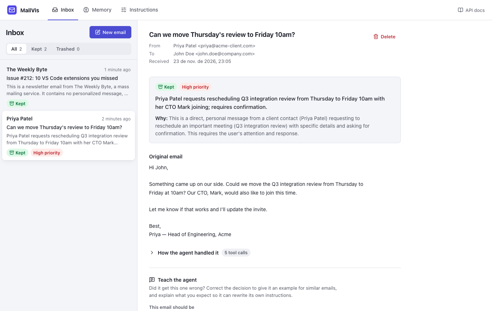
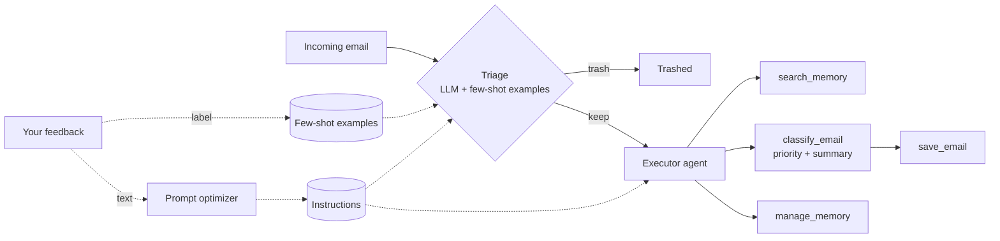

<div align="center">


# MailVis

**An AI email assistant that triages your inbox, prioritizes what matters, remembers context and learns from your corrections.**

Built with LangGraph, FastAPI, PostgreSQL (pgvector) and React.

[](https://github.com/tcunha2004/mailvis/actions/workflows/ci.yml)




</div>

---

## Features

- **Triage** — every incoming email is classified as *keep* or *trash*, with the reasoning shown in the UI.
- **Prioritization & summaries** — kept emails get a `low` / `medium` / `high` priority and a one-line summary.
- **Long-term memory** — the agent stores durable facts it learns (e.g. *"Priya is Head of Engineering at Acme"*) and searches them before handling new emails.
- **Learns from feedback**
  - *Episodic memory*: correcting a decision stores the email as a few-shot example, retrieved by semantic similarity for future triage.
  - *Procedural memory*: free-text feedback runs a prompt optimizer that rewrites the agent's own instructions.
- **Full transparency** — inspect every tool call the agent made, browse and delete memories, and edit or reset its instructions.
- **One command to run** — PostgreSQL, API and web app start together with Docker Compose.

## How it works



| Memory type | What is stored | Where it is used |
|---|---|---|
| **Semantic** | Facts about people, projects and preferences | Executor searches them before classifying |
| **Episodic** | Emails you corrected, with the right label | Triage retrieves the 3 most similar as examples |
| **Procedural** | The agent's instructions (triage rules + workflow) | Rewritten by the optimizer from your feedback |

Everything — emails, agent checkpoints, memories (with vector embeddings), examples and instructions — is persisted in PostgreSQL, so nothing is lost on restart.

## Quick start

**Requirements:** [Docker Desktop](https://www.docker.com/products/docker-desktop/) and access to [AWS Bedrock](https://aws.amazon.com/bedrock/) (Claude Haiku 4.5 and Titan Embeddings v2 enabled in your region).

```bash
git clone https://github.com/tcunha2004/mailvis.git
cd mailvis
cp .env.example .env        # then fill in your AWS credentials
docker compose up -d --build
```

Open **http://localhost:3000** and click **New email** → pick a sample → **Process email**.

| Service | URL |
|---|---|
| Web app | http://localhost:3000 |
| API (Swagger UI) | http://localhost:8000/docs |
| PostgreSQL | `localhost:5432` (user/password/db: `mailvis`) |

Stop with `docker compose down` (add `-v` to also delete the database volume).

## Configuration

All settings are environment variables, read from `.env`:

| Variable | Default | Description |
|---|---|---|
| `AWS_BEARER_TOKEN_BEDROCK` | — | Bedrock API key. Alternatively set `AWS_ACCESS_KEY_ID` / `AWS_SECRET_ACCESS_KEY`. |
| `AWS_REGION` | — | AWS region where the models are enabled. |
| `LLM_MODEL` | `bedrock_converse:global.anthropic.claude-haiku-4-5-20251001-v1:0` | Any LangChain `provider:model` string. |
| `EMBEDDING_MODEL` | `bedrock:amazon.titan-embed-text-v2:0` | Embedding model for semantic search. |
| `EMBEDDING_DIMS` | `1024` | Dimensions of the embedding model. |
| `DEFAULT_USER_ID` | `default` | User used when the `X-User-Id` header is absent. |
| `POSTGRES_USER` / `POSTGRES_PASSWORD` / `POSTGRES_DB` | `mailvis` | Database credentials (Compose). |
| `WEB_PORT` / `API_PORT` / `POSTGRES_PORT` | `3000` / `8000` / `5432` | Host ports (Compose). |

> **Using another provider?** Add its LangChain integration to `backend/pyproject.toml` (e.g. `uv add langchain-openai`) and set `LLM_MODEL=openai:gpt-4.1-mini`, `EMBEDDING_MODEL=openai:text-embedding-3-small`, `EMBEDDING_DIMS=1536`. Changing the embedding dimensions requires a fresh database (`docker compose down -v`).

## API

Interactive docs are served at `/docs`. All endpoints accept an optional `X-User-Id` header, so each user gets isolated emails, memories and instructions.

| Method | Endpoint | Description |
|---|---|---|
| `POST` | `/api/emails` | Process a new email through the agent |
| `GET` | `/api/emails?status=saved` | List processed emails (`saved`, `trashed`, `failed`) |
| `GET` | `/api/emails/{id}` | Email details with the agent's step-by-step trace |
| `DELETE` | `/api/emails/{id}` | Delete an email |
| `POST` | `/api/emails/{id}/feedback` | Correct the decision (`label`) and/or give feedback (`feedback`) |
| `GET` | `/api/memories` | List what the agent remembers |
| `DELETE` | `/api/memories/{id}` | Forget a memory |
| `GET` | `/api/instructions` | Current agent instructions |
| `PUT` | `/api/instructions/{key}` | Edit an instruction |
| `DELETE` | `/api/instructions/{key}` | Reset an instruction to its default |
| `GET` | `/api/health` | Health check (API + database) |

```bash
curl -X POST http://localhost:8000/api/emails \
  -H "Content-Type: application/json" \
  -d '{"author": "Alice <alice@company.com>", "to": "me@company.com",
       "subject": "Contract review by Friday", "body": "Can you review the Acme contract before Friday 5pm?"}'
```

## Local development

Run the database in Docker and the apps on your machine with hot reload:

```bash
docker compose up -d db

# API — http://localhost:8000
cd backend
uv sync
uv run uvicorn mailvis.api.main:app --reload

# Web — http://localhost:5173 (proxies /api to :8000)
cd frontend
npm install
npm run dev
```

Quality checks:

```bash
cd backend && uv run ruff check . && uv run ruff format --check . && uv run pytest
cd frontend && npm run build
```

## Project structure

```
mailvis/
├── backend/
│   ├── src/mailvis/
│   │   ├── agent/
│   │   │   ├── graph.py            # LangGraph: triage → executor
│   │   │   ├── config.py           # LLM and graph state
│   │   │   ├── instructions.py     # editable prompts (procedural memory)
│   │   │   ├── optimizer.py        # rewrites instructions from feedback
│   │   │   └── nodes/
│   │   │       ├── triage/         # keep/trash router with few-shot examples
│   │   │       └── executor/       # ReAct agent + tools (classify, save, memory)
│   │   ├── api/                    # FastAPI app, routes and schemas
│   │   ├── db.py                   # Postgres pool, emails table, checkpointer, store
│   │   └── settings.py
│   ├── tests/
│   └── Dockerfile
├── frontend/
│   ├── src/
│   │   ├── pages/                  # Inbox, Memory, Instructions
│   │   ├── components/             # Compose, EmailDetail, UI primitives
│   │   └── api.ts                  # typed API client
│   ├── nginx.conf
│   └── Dockerfile
├── docker-compose.yml
└── .env.example
```

## Tech stack

| Layer | Technology |
|---|---|
| Agent | [LangGraph](https://langchain-ai.github.io/langgraph/), [LangChain](https://python.langchain.com/), [LangMem](https://langchain-ai.github.io/langmem/) |
| Models | Claude Haiku 4.5 + Titan Embeddings v2 on AWS Bedrock (swappable) |
| API | FastAPI, Pydantic, psycopg 3 |
| Storage | PostgreSQL 17 + pgvector (LangGraph `PostgresSaver` and `PostgresStore`) |
| Web | React 19, TypeScript, Vite, Lucide icons |
| Infra | Docker Compose, nginx, uv, GitHub Actions |

## License

[MIT](LICENSE)
